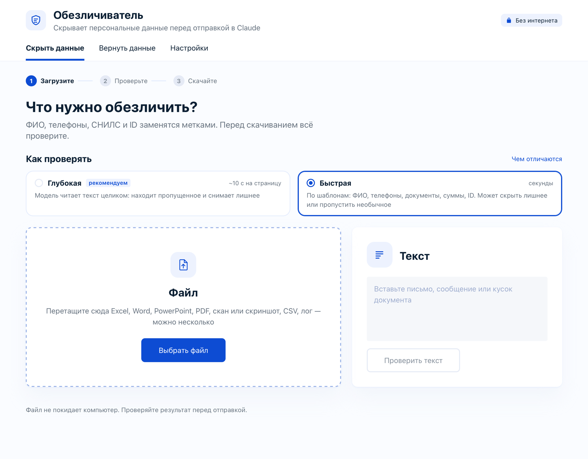
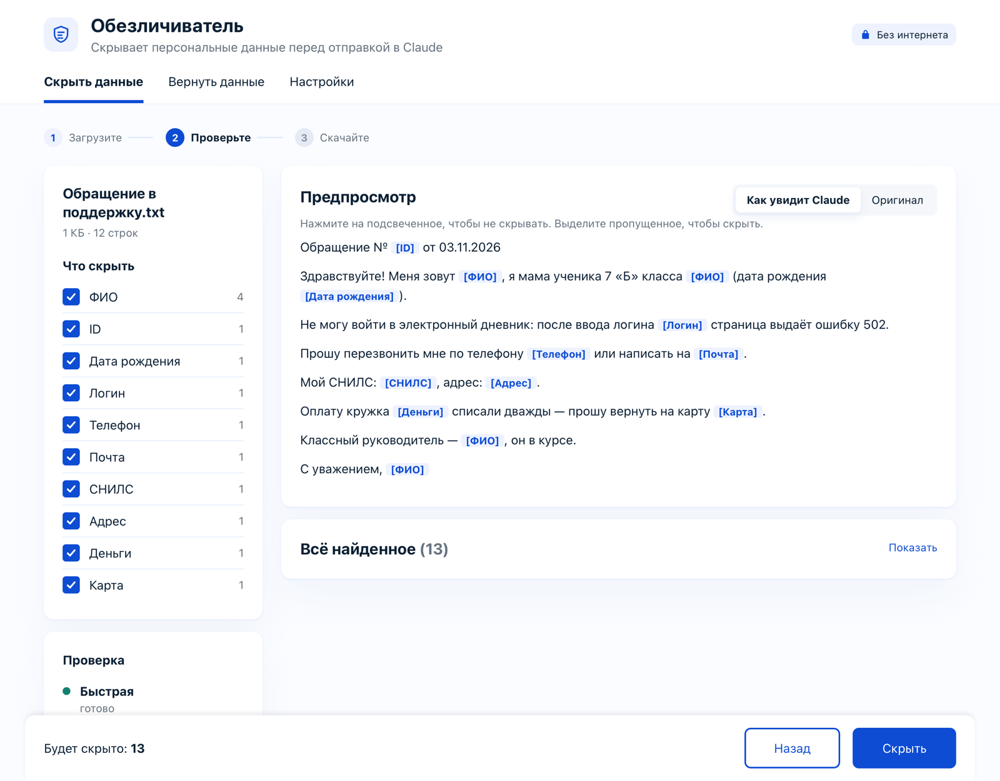
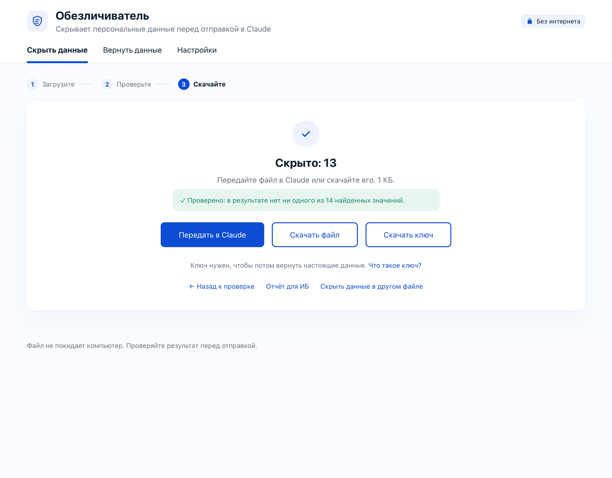

# Обезличиватель

Скрывает персональные данные в Excel, Word, PowerPoint, PDF и тексте **до того, как файл увидит Claude** (или любой другой ИИ).
ФИО, телефоны, почта, СНИЛС, ИНН, паспорт, адреса, даты рождения, школы — заменяются метками
`[ФИО-1]`, `[ТЕЛЕФОН-2]`. Соответствие «метка → настоящие данные» хранится в отдельном ключе на вашем компьютере.
Когда Claude подготовит ответ с метками, ключ возвращает в него настоящие имена.

Всё считается на вашем компьютере. Страница не обращается к интернету — это запрещено её настройками
безопасности (Content-Security-Policy), а не просто обещано.




| Шаг 2: проверка — видно, что будет скрыто | Шаг 3: результат проверен, ключ скачивается отдельно |
|---|---|
|  |  |

<sub>На скриншотах — вымышленные данные.</sub>

---

## Две редакции для раздачи

`python3 tools/package.py` собирает два архива в `dist/`:

| | Для Claude | Без Claude |
|---|---|---|
| Кому | Коллегам, которые работают с Claude Code | Для рабочего компьютера, где нельзя ставить программы |
| Что внутри | Страница, MCP-сервер, защитный хук, скилл `obezlichivatel`, установщики Mac и Windows | Страница, маленький сервер `local_server.py`, запуск одним щелчком (Mac, Windows) |
| «Передать в Claude», режим Claude Code | Есть | Вырезано при сборке (`python3 build.py --edition local`) |
| Глубокая проверка | Ollama ставится кнопкой «Подключить» | Только уже установленная Ollama: ищет, запускает, ничего не скачивает |
| Установка | `install.sh` / `install.cmd` | Не нужна: распаковать и открыть |
| Инструкция | `docs/README-claude.md` | `docs/README-local.md` |

## Два способа

| | Страница | MCP для Claude Code |
|---|---|---|
| Что это | Один файл `Обезличиватель.html` | Сервер, через который Claude сам просит обезличить файл |
| Установка | Не нужна: открыть в браузере. Ярлык «Обезличиватель» делает установщик: Mac — `install.sh`, Windows — `install.cmd` | Mac — `bash install.sh`, Windows — `install.cmd` |
| Где работает | Любой компьютер: Mac, Windows, рабочий без прав администратора | Mac, Windows, Linux с Claude Code и Python 3.8+ |
| Как отправить в Claude | «Передать в Claude» (через ярлык) или скачать файл и перетащить в чат | Claude получает его сам после вашей проверки |
| Защита от ошибки | Вы сами решаете, что отправить | Хук запрещает Claude читать папки с настоящими данными |

В обоих случаях используется одна и та же страница и одни и те же правила поиска.

---

## Страница: как пользоваться

Три шага, как в iLovePDF: **Загрузите → Проверьте → Скачайте**.

1. Откройте ярлык «Обезличиватель» (или `Обезличиватель.html` в Chrome, Яндекс Браузере, Edge, Safari).
2. Выберите, **как проверять**: «Глубокая» (модель находит пропущенное и снимает лишнее, ~10 секунд на страницу)
   или «Быстрая» (шаблоны, секунды). Выбор запоминается.
3. Перетащите файл — Excel, Word, PowerPoint, PDF, CSV, логи, текст — или вставьте текст. Можно сразу несколько файлов:
   они пойдут по очереди, каждый со своей проверкой, а метки будут общими («Петрова» — [ФИО-1] во всех файлах). Пока идёт проверка, видно полосу прогресса
   и этапы: поиск по шаблонам → поиск имён → модель ищет пропущенное → модель снимает лишнее (сколько частей
   прочитано и сколько осталось ждать). «Остановить и показать найденное» — перейти к результату, «Назад» — отменить.
4. Проверьте:
   - **Что скрыть** — галочки по типам: ФИО, телефоны, ID… Снимите, если тип не нужен.
   - **Предпросмотр** — «Как увидит Claude» и «Оригинал». Нажмите на выделенное, чтобы не скрывать.
   - **Столбцы** — какие столбцы скрываются целиком.
   - **Скрыть ещё** — впишите то, что пропущено, или просто выделите текст в предпросмотре и нажмите «Скрыть».
   - **Не скрывать никогда** — кнопка у найденного значения: слово больше не будет скрываться ни в одном файле.
   - **Проверка** — какой режим поиска работает (см. ниже). «Проверить глубже» — запустить локальную модель.
5. «Скрыть» → дальше на выбор:
   - **Передать в Claude** — копия ляжет в `~/Обезличиватель/Обезличенные`, ключ — в `~/Обезличиватель/.ключи`.
     Страница даст запрос, который нужно вставить в чат Claude Code. Файл не привязан к одной сессии:
     его найдёт любой чат Claude Code на этом Mac, где подключён Обезличиватель (инструмент `obezl_masked`).
     Кнопка есть, когда страница открыта через ярлык.
   - **Скачать файл** — обезличенная копия «… (обезличено).docx», её можно перетащить в любой чат.
   - **Скачать ключ** — себе. Ключ — это шпаргалка «метка → настоящие данные»: `[ФИО-3]` → Петрова Анна Сергеевна.
     Он нужен, чтобы вернуть имена в ответ Claude. В ключе настоящие данные — в Claude его не отправляйте.

### Два режима проверки

**Глубокая (рекомендуем)** — модель читает текст целиком: находит пропущенное и снимает лишнее.
Выбрана по умолчанию, если модель подключена. Этапы:
1. **Поиск по шаблонам** — ФИО, телефоны, документы, суммы, ID, логины, серверы (правила, словарь, нейросеть Natasha).
2. **Модель ищет пропущенное** — читает текст, где найденное уже заменено на `[ТИП]`, и называет то, что шаблоны
   не поймали: «Колян», «двенадцать миллионов рублей», подрядчика без «ООО», пароль без слова password.
3. **Модель снимает лишнее** — смотрит на каждую находку шаблонов в её окружении и снимает то, что скрыто зря:
   названия модулей и разделов, термины с фамилиями (диаграмма Ганта), роли (admin). Снятое помечено в списке
   «снято моделью», кнопка «Вернуть снятое» возвращает всё разом.

**Быстрая** — только шаблоны, за секунды. Может скрыть лишнее или пропустить необычное — проверьте результат.
Для огромных файлов и компьютеров без модели.

| | Глубокая | Быстрая |
|---|---|---|
| Скорость | ~10 с на страницу (1 500 знаков); первые 120 000 знаков; можно остановить | Секунды даже на больших файлах |
| Нужно | Ollama и модель на этом компьютере (~3,5–5 ГБ), 8 ГБ памяти, лучше 16 | Ничего |
| Интернет | Нет: модель работает на компьютере, текст никуда не уходит | Нет |

**Чтобы модель не открыла лишнего.** Пропущенные данные хуже лишней метки, поэтому:
- снимать модель может только находки типов ФИО, организация, адрес, дата рождения, логин. Телефоны, СНИЛС, ИНН,
  паспорта, карты, деньги, ID, пароли, школы и номера договоров найдены по строгому формату — их она не трогает;
- поверх её решения код не снимает: ФИО с отчеством или инициалами, логин с цифрами или `_`, адрес с улицей и домом,
  дату рядом со словом «рождения», имя или компанию после «согласовала», «ответственный», «подрядчик», «клиент»…;
- модель отвечает по каждой находке отдельно и повторяет её значение — если номер и значение не сходятся, ничего не снимается.

На контрольных примерах: снято лишнего 7 из 8, настоящих данных снято зря — 0 из 11 (`tests/review_eval.py`).

**Подключить.** На первом шаге выбрать «Глубокая» → «Подключить» (или «Настройки» → «Глубокая проверка»).
Mac: если есть комплект Славатора, Ollama и модель ставятся из него без скачивания, иначе — с ollama.com.
Windows: Ollama ставится тихо, без прав администратора, модель qwen3:4b (~2,6 ГБ) скачивается с ollama.com.
Если Ollama установлена, но не запущена (после перезагрузки), страница запускает её сама. Если модели нет,
перед проверкой появится окно: «Подключить модель», «Проверить быстро» или «Отмена» — без модели глубокая не подменяется молча быстрой.

**Надёжность.** Ответ модели ограничен по длине, каждый кусок — двумя минутами: не ответивший кусок пропускается,
после трёх таких подряд проверка останавливается и показывает найденное. Ответы, которых нет в тексте дословно,
названия полей перед метками («Подрядчик [ОРГАНИЗАЦИЯ]»), метки времени, имена потоков, числа с единицами
(«30000 ms») и номера не того формата отбрасываются.

**Проверка результата.** После «Скрыть» Обезличиватель ищет в готовом файле всё, что нашёл и должен был скрыть:
в тексте (куски Word склеиваются по абзацам), в скрытых именах фигур и замещающем тексте картинок, в авторах
комментариев, в имени файла. Если что-то осталось — показывает что и кнопку «Скрыть и их».

**Отчёт для ИБ.** На последнем шаге — текстовый отчёт: когда, какой режим, сколько и каких данных скрыто, какие
столбцы целиком, что оставлено вручную или снято моделью, итог проверки результата. Значений в отчёте нет.

**Вернуть данные.** Вкладка «Вернуть данные»: ключ + ответ Claude (файл или текст) → «Вернуть данные».

**Несколько файлов.** «Настройки» → «Общие метки для нескольких файлов»: загрузите ключ от прошлого файла.

**Свои правила.** «Настройки» → «Всегда скрывать» и «Никогда не скрывать».

## MCP для Claude Code

### Установка (Mac)

```bash
bash install.sh
```

Скрипт:
1. копирует сервер в `~/obezlichivatel-mcp`;
2. создаёт рабочие папки в `~/Обезличиватель`:
   - `Сырые` — сюда кладёте файлы с данными;
   - `Обезличенные` — результат, с ним работает Claude;
   - `С данными` — файлы, куда возвращены настоящие данные;
   - `.ключи` — ключ;
3. подключает сервер к Claude Code (`claude mcp add obezlichivatel`);
4. делает ярлык «Обезличиватель»: приложение в `~/Applications` (видно в Launchpad и Spotlight) и ярлык на Рабочем столе;
5. добавляет в `~/.claude/settings.json` защитный хук. Он не даёт Claude прочитать `Сырые`, `С данными`
   и `.ключи` никаким способом, кроме инструментов Обезличивателя. Прежние настройки сохраняются в `settings.json.bak`.

Перезапустите Claude Code.

### Как пользоваться

Положите файл в `~/Обезличиватель/Сырые` и скажите Claude:

> Обезличь свежий файл из Сырых и посчитай, на что чаще всего жалуются.

Claude откроет в браузере страницу проверки. Посмотрите, что будет скрыто, и нажмите
«Скрыть и отдать Claude». Дальше Claude работает с обезличенным файлом.

Чтобы получить итоговый документ с настоящими именами:

> Сделай письмо-ответ каждому заявителю в Word и верни в него данные.

Claude подготовит документ с метками и вызовет `obezl_unmask`. Файл с настоящими данными появится в
`~/Обезличиватель/С данными`, а Claude его содержимое не увидит.

Текст из письма или чата: скопируйте его и скажите «обезличь буфер обмена».

### Инструменты

| Инструмент | Что делает |
|---|---|
| `obezl_files` | Список файлов в «Сырые» (имена скрыты — в них бывают фамилии) |
| `obezl_mask_file` | Открыть страницу проверки для файла: номер из списка или путь |
| `obezl_mask_clipboard` | То же для текста из буфера обмена |
| `obezl_result` | Получить обезличенный файл после проверки |
| `obezl_masked` | Список обезличенных файлов — в том числе переданных со страницы кнопкой «Передать в Claude» |
| `obezl_read` | Читать обезличенный файл постранично: абзацы Word, строки Excel |
| `obezl_unmask` | Вернуть данные в файл, который сделал Claude |
| `obezl_open_page` | Открыть страницу для ручной работы |
| `obezl_status` | Папки, защита, сколько меток в ключе (без значений) |

### Установка (Windows)

Распакуйте архив и дважды щёлкните `install.cmd`. Права администратора не нужны. Установщик:
1. находит Python 3.8+ (`py -3` или `python`). Нет Python — ставит только страницу и ярлык на неё:
   быстрая проверка правилами работает, а для Natasha, глубокой проверки и Claude Code нужен Python с python.org;
2. копирует сервер в `%USERPROFILE%\obezlichivatel-mcp`, рабочие папки — в `%USERPROFILE%\Обезличиватель`;
3. подключает сервер к Claude Code и добавляет защитный хук (понимает пути вида `C:\Users\…\Сырые`);
4. спрашивает, ставить ли Natasha (около 100 МБ через pip);
5. делает ярлык «Обезличиватель» на Рабочем столе и в «Пуске». Ярлык запускает сервер без окна консоли и открывает страницу.

---

## Как ищет: правила + нейросеть

1. **Правила** — быстрые и предсказуемые, работают везде, даже на рабочем компьютере без установки.
   ФИО во всех падежах и латиницей, телефоны, почта, СНИЛС, ИНН, паспорт, адреса, деньги, реквизиты, номера договоров,
   организации, серверы и URL, методы API и классы, ID, логины, пароли и токены в логах.
2. **Словарь русского языка** (OpenCorpora, 3 млн словоформ, встроен в страницу) — отличает фамилии от обычных слов
   с такими же окончаниями: «Корзина», «Машина», «Причина», «Логин», «Вопросов» не скрываются, а «Кузнецов», «Морозова»,
   «Попов» — скрываются. Притяжательные «Иванова книга» не сбивают: Иванова остаётся фамилией.
3. **Распространение по файлу** — найденное однажды скрывается везде: логин из строки «User ivanov.ii» — и во всех
   остальных строках лога; «ПАО «Аэрофлот»» — и просто «Аэрофлот»; по фамилии «Смирнова» узнаются логины
   `smirnova_ea`, `e.smirnova`.
4. **Нейросеть Natasha** — локальная модель для русского языка (без интернета). Находит людей по смыслу там, где правила
   бессильны: «Вано Мурадели», «Ли Минхо», «передать Аскару Жумабаеву». Включается сама, если открыть Обезличиватель
   через ярлык или из Claude. Найденное отмечено в списке значком «ИИ».

Качество на размеченных примерах (логи приложений, nginx, JSON, ЧТЗ, ПМИ, служебные записки):

| Набор | Найдено |
|---|---|
| Основной (по нему настраивались правила) | 67 из 67 |
| Контрольный | 31 из 31 |
| Слепой (написан после настройки) | 22 из 23 |
| Типичные ЧТЗ, ПМИ, JSON/XML-логи | 40 из 40 |
| Word с ПДн: лог одним абзацем, JSON Lines, access log, реестр таблицей | 3836 из 3836 |
| Текст без персональных данных | ни одного ложного срабатывания |

5. **Локальная модель qwen3:8b** (режим «Глубокая») — читает текст по смыслу. На контрольных фразах, включая строки логов: 19 из 20,
   ни одного лишнего («Корзина», «диаграмма Ганта», «кабинет 214» не скрываются).

## Что находит

| Тип | Как |
|---|---|
| ФИО и имена | Словарь имён во всех падежах, отчества, фамилии по окончаниям, инициалы («Петров И. И.»), ЗАГЛАВНЫЕ, уменьшительные («Саша»), подсказки («учитель …», «заявитель …»). «Анна» и «Анна Сергеевна Петрова» в одном файле получают одну метку |
| Телефоны | Мобильные и городские, в любом написании, в том числе числом в ячейке Excel |
| Почта, ники | `name@mail.ru`, `@username`, ссылки vk.com, t.me |
| СНИЛС, ИНН, карты | С проверкой контрольной суммы — случайные числа не путаются с документами |
| Паспорт, полис, счёт | По формату и словам рядом («паспорт», «полис ОМС», «р/с») |
| Даты рождения | Только рядом со словами «рождения», «г. р.» или в столбце «Дата рождения». Сроки и даты встреч остаются |
| Адреса | Улица с домом и квартирой, индекс и город |
| Школы | «МБОУ «СОШ № 5»», «гимназия № 3», «лицей № 12» |
| ID | Номера учеников, пользователей, заявок, UUID, `userId=…`, `"studentId": …` в логах и JSON, «ID 12345», длинные номера. Столбцы «ID ученика», «studentId», «Идентификатор», «Код ученика» скрываются целиком |
| Логины | Столбец «Логин», `login=…`, «логин petrov_v», «Логин в стенд: smirnov_op», «учётка ivanov_a», `@username` |
| Пароли и токены | `password=…`, `token=…`, `Bearer …`, JWT (`eyJ…`), «Пароль от стенда: Qwerty123», «PIN 4821». Фразы вроде «пароль должен содержать 8 символов» не трогает |
| Деньги | Таблицы с подписью «тыс. руб.» (числа в ячейках; ставки и номера периодов не трогает), `15 млн 50 тыс. руб.`, `12 450 000 (…) рублей 00 копеек`, `2 075 000,00 руб.`, `3,735 млн ₽`, `USD 1,200.00`, `amount=15000.50`, столбцы «Сумма», «Стоимость» |
| Реквизиты, договоры | ИНН/КПП/ОГРН/БИК организаций, р/с и к/с, «контракт № …», «счёт № СЧ-2026/117» |
| Организации | `ПАО «Аэрофлот»`, `ООО Ромашка-Софт` |
| Серверы и адреса | URL, JDBC-строки, домены, `db-prod-01`, `\\fs01\share`, `user@host`, IP и MAC |
| Методы | `GET /api/v1/students/…`, классы и методы из стектрейсов (`ru.example….GradeService.save`) |
| Прочее | Госномера |

### Как меняются ID

По умолчанию ID заменяется **другим ID того же вида**, а не меткой: число — числом, UUID — UUID, `AB-1234` — `KX-8302`.

- **Уникально.** Каждый новый ID проверяется: он не совпадает ни с выданными раньше, ни с настоящими ID из файла.
  Короткие номера (1, 2, 17) получают шестизначные — так хватает места, чтобы не было совпадений.
- **Одинаково.** Один и тот же ID везде меняется одинаково — в разных столбцах, листах и файлах (в MCP общий ключ,
  на странице — «Настройки» → «Общие метки для нескольких файлов»). Поэтому связи между таблицами, подсчёты и группировки остаются верными.
- **Числа остаются числами.** В Excel числовой ID остаётся числом, по нему можно сортировать и сводить.
- **Обратимо.** Ключ возвращает настоящие ID в ответ Claude так же, как имена.

Если удобнее метки `[ID-1]`, переключите в «Настройках».

**PDF** превращается в текст прямо на странице (встроенная библиотека pdf.js от Mozilla, без интернета) и дальше
проверяется как текст. Результат — текстовый файл с отметками «── Страница N ──»: Claude читает текст, а не вёрстку.
Переносы строк внутри абзацев склеиваются обратно. Таблицы восстанавливаются по координатам: заголовки «ФИО»,
«СНИЛС», «Дата рождения» задают тип столбца, перенос внутри ячейки («7479 / 263201») собирается в одно значение.
Сканы без текстового слоя прочитать нельзя — страница прямо об этом скажет.

В PowerPoint — слайды, заметки докладчика, шаблоны и макеты, таблицы на слайдах, комментарии и их авторы,
скрытые имена фигур (PowerPoint и Keynote копируют в них текст слайда).

В Excel проверяются все листы, включая скрытые, комментарии, кэш сводных таблиц и диаграмм, автор в свойствах файла.
В Word — основной текст, таблицы (столбцы «ФИО», «Паспорт», «Телефон»… скрываются целиком по заголовку), колонтитулы, сноски, комментарии, исправления и их авторы, ссылки mailto.
Форматирование, формулы в остальных ячейках, стили и картинки сохраняются. Числа и даты, ставшие метками,
при возврате данных снова становятся числами и датами со своим форматом, а не текстом.

**Большие файлы.** Файл читается и записывается по частям, целиком в память не загружается.
Таблица на 300 000 строк (25 МБ): поиск — около 20 секунд, запись — около 15.

## Чем отличается от других обезличивателей

| | Обезличиватель | Presidio (Microsoft) | Limina (Private AI), Tonic Textual | Nightfall, Velum, Paste Shield | Obscura, API Guard (Россия) |
|---|---|---|---|---|---|
| Где работает | На компьютере, без интернета | Свой сервер | Облако или свой контур | Расширение браузера | Шлюз в контуре компании |
| Русские ФИО во всех падежах, словарь обычных слов | Да | Нет из коробки | Частично | Нет | NER spaCy |
| СНИЛС, ИНН с контрольной суммой | Да | Нет из коробки | Нет | Нет | Да |
| Проверка человеком перед отправкой | Да, с предпросмотром | Нет | Да (Textual) | Предупреждение | Режим «предупреждать» |
| Локальная модель «по смыслу» | Да: ищет пропущенное и снимает лишнее | NER | Свои модели | ML-детекторы | Нет |
| Excel, Word, PowerPoint с сохранением формата | Да | Только текст | Да, плюс PDF и картинки | Только ввод в чат | Только запросы |
| PDF | Текст с таблицами, без сканов | Нет | Да, с распознаванием сканов | Нет | Картинки через OCR |
| Возврат данных в ответ | Да, по ключу; числа и даты — с форматом | Только шифрование | Да | Velum — да | Да, на лету |
| Проверка результата и отчёт для ИБ | Да | Нет | Аудит в облаке | Журнал | Журнал, симулятор политик |
| Интеграция с Claude Code и защита от чтения сырых файлов | Да (MCP + хук) | Нет | Нет | Нет | Адаптер Anthropic API |

Чего у других есть, а здесь пока нет: распознавание сканов и картинок (Limina, Tonic, Obscura), перехват вставки
прямо в чат браузера (Nightfall, Velum), правдоподобные подставные имена вместо меток (Tonic, Limina, Obscura).
Подставные имена здесь не используются намеренно: в русском их пришлось бы склонять, а метки [ФИО-1] Claude
понимает без ошибок и они точно возвращаются ключом.

## Чего не умеет

- Не видит данные на **картинках** (сканы, скриншоты, подписи) — предупреждает, сколько их в файле.
- Не распознаёт **сканы** (PDF и картинки без текстового слоя).
- Не читает `.doc`, `.xls` и `.ppt` — их нужно пересохранить в `.docx` / `.xlsx` / `.pptx`.
- PDF возвращается **текстом**, а не PDF с закрашенными местами: вёрстка и картинки не сохраняются.
- Не открывает файлы **под паролем**.
- **Хук страхует от случайности, а не от умысла.** Он останавливает команды, где защищённая папка указана в пути.
  Скрипт, который сам собирает путь внутри себя, хук не увидит. Поэтому сервер ещё и даёт Claude правило в инструкциях,
  а файлы с данными стоит класть только в «Сырые».
- Автоматический поиск не бывает идеальным: редкие имена без отчества и фамилии могут пропуститься.
  Поэтому проверка перед отправкой — обязательная часть, а не опция.

## Для информационной безопасности

- **Метод.** Замена идентификаторами с раздельным хранением таблицы соответствия (ключа).
- **Где обработка.** Только на компьютере пользователя. Страница запрещает себе сетевые запросы через CSP;
  MCP-сервер слушает только `127.0.0.1`, каждое задание защищено случайным токеном.
- **Ключ.** Хранится локально, права доступа — только владелец (`chmod 600`).
- **Статус.** Это не сертифицированное средство защиты информации. Перед использованием на реальных данных
  согласуйте инструмент с ИБ.

## Разработка

```
src/engine.js   — поиск персональных данных и выдача меток (общий для страницы и тестов)
src/zip.js      — потоковое чтение и запись ZIP (docx, xlsx — это ZIP)
src/office.js   — Excel, Word, CSV и текст: анализ, запись, возврат данных
src/worker.js   — фоновый поток страницы
src/ui.js, index.html, styles.css — интерфейс
mcp/server.py   — MCP-сервер (только стандартная библиотека Python)
mcp/guard.py    — защитный хук Claude Code
mcp/ner_worker.py — нейросеть Natasha: поиск людей по смыслу (запускается сервером)
mcp/llm.py      — глубокая проверка: установка Ollama и модели (Mac, Windows), запрос к модели, фильтр ответов
vendor/pdfjs/   — pdf.js 6.4.299 (Mozilla, Apache-2.0): встраивается в страницу для чтения PDF
mcp/local_server.py — сервер редакции «без Claude»: страница, поиск Ollama, распознавание; ничего не хранит
mcp/ocr.swift   — распознавание сканов Apple Vision (собирается установщиком; mcp/ocr-macos — готовая сборка)
skill/obezlichivatel/SKILL.md — скилл для Claude Code: как работать с файлами с данными через Обезличиватель
tools/package.py — два архива для раздачи
mcp/install_hook.py — добавляет хук в settings.json (для установщика Windows)
install.sh      — установка на Mac и Linux;  install.cmd + install.ps1 — на Windows
tests/corpus*.txt — размеченные примеры: что должно скрываться и что остаться
src/lexicon.js  — словарь обычных слов, похожих на фамилии (собирается tools/build_lexicon.py из OpenCorpora)
launcher/       — ярлык для macOS: иконка и make_launcher.sh
build.py        — собирает dist/Обезличиватель.html в один файл
```

```bash
python3 build.py                                          # собрать страницу
osascript -l JavaScript tests/run_engine_tests.js "$PWD"   # тесты поиска (Mac)
osascript -l JavaScript tests/run_corpus.js "$PWD" [подробно] [tests/corpus_blind.txt]   # полнота на размеченных примерах
python3 tests/llm_eval.py                                 # глубокая проверка: полнота и лишнее (нужна Ollama)
python3 -m unittest discover -s tests -v                   # тесты сервера и хука
python3 tests/make_samples.py /tmp/образцы 300000          # синтетические файлы для проверки
swift tests/webkit_check.swift dist/Обезличиватель.html /tmp/образцы/*   # страница в WebKit (как Safari из ярлыка)
swift tests/webkit_shot.swift dist/Обезличиватель.html shot.png 1440 900 [файл] [done]   # снимок экрана
python3 tests/make_pdn_docx.py /tmp/pdn.docx /tmp/pdn.json 600     # Word с ПДн: логи, JSON, access log, реестр
swift tests/webkit_mask.swift http://127.0.0.1:47630/ /tmp/pdn.docx /tmp/out.docx && python3 tests/check_leaks.py /tmp/out.docx /tmp/pdn.json
swift tests/webkit_roundtrip.swift dist/Обезличиватель.html файл.pptx скрыто.pptx возвращено.pptx && python3 tests/compare_text.py файл.pptx возвращено.pptx   # туда и обратно
swift tests/make_pdf.swift документ.html документ.pdf     # PDF с текстовым слоем для проверки
python3 tests/review_eval.py                              # «снимает лишнее»: не снимает ли настоящие данные (нужна Ollama)
```

---

## Правовая информация

- **Не связан с Anthropic.** Claude — товарный знак Anthropic, PBC; название используется только чтобы указать,
  с чем совместим Обезличиватель. Проект не связан с порталом «Госуслуги», государственными органами и другими
  упомянутыми компаниями; их названия — товарные знаки владельцев.
- **Не сертифицированное средство защиты информации** и не гарантия соответствия 152-ФЗ «О персональных данных».
  Автоматический поиск может ошибаться: результат перед отправкой проверяет человек. Перед работой с реальными
  данными согласуйте использование со службой информационной безопасности.
- **Тестовые данные вымышлены** (`tests/`, скриншоты): имена, телефоны, СНИЛС, адреса и номера сгенерированы,
  совпадения с реальными людьми случайны. Домены — `example.ru`, `example.local`.
- **Сторонние компоненты** и их лицензии — в [THIRD_PARTY_NOTICES.md](THIRD_PARTY_NOTICES.md): pdf.js (Apache-2.0)
  встроен в страницу, список слов из словаря OpenCorpora (CC BY-SA 3.0) — в `src/lexicon.js`.
